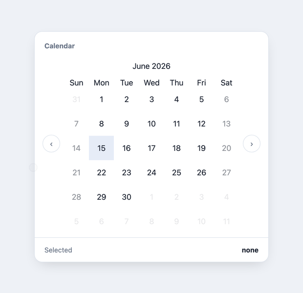

# @krjakbrjak/calendar


A React component that displays a month grid. It can select a single date or a range.



## Install

```bash
npm install @krjakbrjak/calendar
```

## Usage

```jsx
import React, { useState } from 'react';
import { Calendar } from '@krjakbrjak/calendar';

const App = () => {
    const [date] = useState(new Date());

    return (
        <Calendar
            month={date.getMonth()}
            year={date.getFullYear()}
            selectRange
            onDateSelected={(first, second) => {
                console.log(first, second);
            }}
        />
    );
};
```

Styles are injected by the bundle, there is no separate CSS file to import.

## Styling

The component reads three CSS custom properties. Set them on any ancestor:

```css
:root {
    --primaryColor: #1c2331;
    --secondaryColor: #e6ecf7;
    --accentColor: #cfe0ff;
}
```

| Property | Default | Applies to |
| --- | --- | --- |
| `--primaryColor` | `black` | Weekday text colour |
| `--secondaryColor` | `gray` | Background of today, and of the day under the cursor |
| `--accentColor` | `lightgray` | Background of a selected range |

`--secondaryColor` covers both today and hover, so those cannot be styled
apart. Weekend and adjacent-month days are dimmed with opacity and cannot be
themed at all.

## Switching months

There are no built-in previous/next controls. The parent drives `year` and `month`:

```jsx
const [date, setDate] = useState(new Date());

const shiftMonth = (offset) => {
    const next = new Date(date);
    next.setMonth(next.getMonth() + offset);
    setDate(next);
};

return (
    <div style={{ display: 'flex' }}>
        <button onClick={() => shiftMonth(-1)} type="button">&lt;</button>
        <Calendar month={date.getMonth()} year={date.getFullYear()} />
        <button onClick={() => shiftMonth(1)} type="button">&gt;</button>
    </div>
);
```
